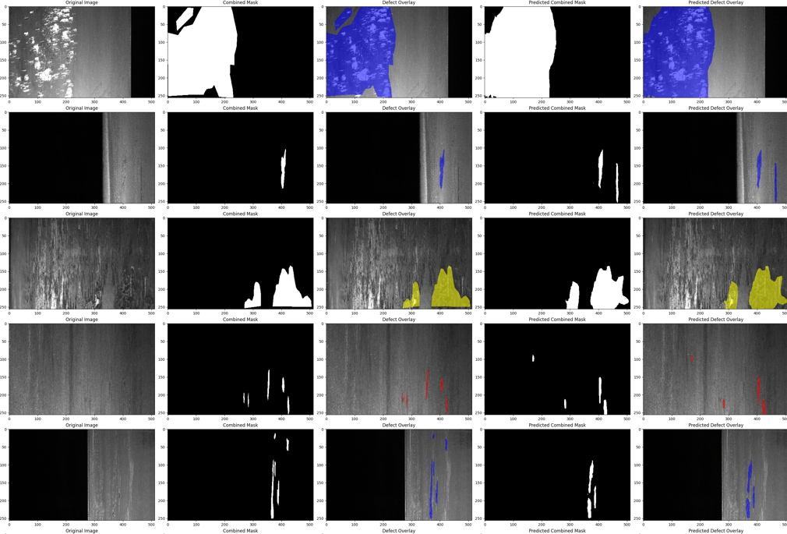

# Steel Defect Segmentation Using Deep Learning

Multi-class steel surface defect segmentation using the Severstal Steel Defect Detection dataset.

## Overview

This project investigates seven deep learning model configurations for automated steel surface defect segmentation. The goal is to identify and localize defects at the pixel level while distinguishing between four defect classes.

The evaluated architectures include FPN, U-Net, U-Net++, DeepLabV3, and SegFormer, using ResNet-50, EfficientNet-B4, and MiT-B2 backbones. Models are compared using macro-averaged Dice and Intersection over Union (IoU).

The project includes baseline experiments trained for 30 epochs and extended experiments trained for 200 epochs. Inference performance was also benchmarked at batch sizes of 1, 4, 8, and 16 to evaluate the trade-off between segmentation quality and processing throughput.

### Best-performing model

| Metric | Result |
| --- | --- |
| Model | SegFormer with MiT-B2 |
| Training duration | 200 epochs |
| Macro Dice | 0.6339 |
| Macro IoU | 0.4772 |

SegFormer with MiT-B2 achieved the highest reported segmentation metrics. FPN with EfficientNet-B4 remains a strong alternative, with competitive segmentation performance and higher measured throughput at larger batch sizes.

## Motivation

Steel surface quality inspection is an important part of industrial manufacturing. Surface defects can affect product quality, reliability, and suitability for downstream applications. Deep learning offers a way to automate defect detection and localization, enabling more consistent and scalable quality control.

Steel defect segmentation is challenging because defects vary in shape, size, orientation, and appearance. In addition, the dataset contains four defect classes with different distributions, making accurate segmentation a challenging computer vision task.

The main objectives of this project are to:

- Compare different deep learning architectures for steel surface defect segmentation.
- Investigate the impact of model and backbone selection on segmentation performance.
- Evaluate CNN-based and transformer-based approaches.
- Analyze the effects of extended training and identify signs of overfitting.
- Compare inference latency and throughput across model configurations.
- Identify promising configurations for accuracy-sensitive and throughput-sensitive applications.

## Dataset

The project uses the [Severstal: Steel Defect Detection dataset](https://www.kaggle.com/c/severstal-steel-defect-detection) from Kaggle.

The dataset consists of steel surface images and pixel-level annotations identifying defects. The segmentation task requires predicting defect locations and distinguishing between four defect classes.

### Dataset characteristics

| Property | Description |
| --- | --- |
| Domain | Industrial manufacturing and quality inspection |
| Input | Steel surface images |
| Output | Pixel-level segmentation masks |
| Number of defect classes | Four, identified by class IDs 1–4 |
| Annotation format | Run-length encoding (RLE) |
| Source | Kaggle Severstal Steel Defect Detection competition |

An image may contain no defects, one defect class, or multiple defect classes. The dataset uses numeric class IDs rather than descriptive defect names.

## Methodology

### Model architectures

Seven model configurations were trained and evaluated.

| Model | Backbone |
| --- | --- |
| FPN | EfficientNet-B4 |
| FPN | ResNet-50 |
| U-Net | ResNet-50 |
| SegFormer | MiT-B2 |
| U-Net++ | EfficientNet-B4 |
| U-Net++ | ResNet-50 |
| DeepLabV3 | ResNet-50 |

### Architecture descriptions

#### FPN with ResNet-50

Feature Pyramid Network combines features at multiple spatial resolutions. Its multi-scale feature aggregation helps identify defects with different sizes and spatial characteristics.

#### FPN with EfficientNet-B4

This configuration combines Feature Pyramid Network with EfficientNet-B4 as the encoder, leveraging multi-scale feature aggregation and efficient feature extraction for defect localization.

#### U-Net with ResNet-50

U-Net uses an encoder-decoder structure with skip connections to combine semantic information with spatial details.

#### DeepLabV3 with ResNet-50

DeepLabV3 uses atrous convolutions and spatial pyramid pooling to capture contextual information at multiple scales.

#### U-Net++ with ResNet-50

U-Net++ extends U-Net with nested skip connections to improve feature fusion between encoder and decoder stages.

#### U-Net++ with EfficientNet-B4

This configuration combines the nested skip connections of U-Net++ with EfficientNet-B4 as the encoder.

#### SegFormer with MiT-B2

SegFormer uses a hierarchical transformer encoder to learn image features and a lightweight decoder to produce segmentation predictions.

### Evaluation metrics

Model performance is evaluated using macro-averaged Dice and Intersection over Union (IoU).

## Experimental Setup

The initial experiments trained all seven model configurations for 30 epochs. Extended training experiments were conducted for FPN with EfficientNet-B4, FPN with ResNet-50, and SegFormer with MiT-B2.

Selected models were trained for up to 200 epochs using learning-rate scheduling.

The extended experiments investigated whether longer training improved segmentation performance and whether different architectures exhibited different generalization behavior.

FPN with ResNet-50 showed signs of overfitting beginning at approximately epoch 35 based on the observed validation-loss trend. This highlights the importance of validation monitoring and checkpoint selection rather than assuming that additional training always improves generalization.

Inference performance was benchmarked using batch sizes of 1, 4, 8, and 16. The benchmark measured batch latency, average time per image, and throughput.

## Results

### Segmentation visualization

### 1. Initial comparison: 30 epochs

| Model | Epochs | Macro Dice | Macro IoU |
| --- | ---: | ---: | ---: |
| FPN + EfficientNet-B4 | 30 | 0.5861 | 0.4293 |
| FPN + ResNet-50 | 30 | 0.5732 | 0.4200 |
| SegFormer + MiT-B2 | 30 | 0.5361 | 0.3962 |
| DeepLabV3 + ResNet-50 | 30 | 0.5188 | 0.3818 |
| U-Net++ + ResNet-50 | 30 | 0.5159 | 0.3789 |
| U-Net + ResNet-50 | 30 | 0.3675 | 0.2900 |
| U-Net++ + EfficientNet-B4 | 30 | 0.3617 | 0.2835 |

FPN with EfficientNet-B4 achieved the highest Dice and IoU scores in the initial 30-epoch comparison.

### 2. Extended training: 200 epochs

| Model | Epochs | Macro Dice | Macro IoU |
| --- | ---: | ---: | ---: |
| SegFormer + MiT-B2 | 200 | 0.6339 | 0.4772 |
| FPN + EfficientNet-B4 | 200 | 0.6064 | 0.4500 |

#### SegFormer with MiT-B2

SegFormer improved from a Dice of 0.5361 and an IoU of 0.3962 after 30 epochs to a Dice of 0.6339 and an IoU of 0.4772 after 200 epochs.

Absolute improvements:

- Dice: +0.0978
- IoU: +0.0810

#### FPN with EfficientNet-B4

FPN with EfficientNet-B4 improved from a Dice of 0.5861 and an IoU of 0.4293 after 30 epochs to a Dice of 0.6064 and an IoU of 0.4500 after 200 epochs.

Absolute improvements:

- Dice: +0.0203
- IoU: +0.0207

These results indicate that the effect of extended training varies between architectures.

#### FPN with ResNet-50

FPN with ResNet-50 showed signs of overfitting beginning at approximately epoch 35. Further training of this model was stopped.

### 3. Inference performance

Inference throughput measures the number of images processed per second. Batch latency measures the time required to process an entire batch, while average time per image is calculated by dividing batch latency by batch size.

#### FPN with EfficientNet-B4

| Batch size | Batch latency (ms) | Average time per image (ms) | Throughput (images/s) |
| ---: | ---: | ---: | ---: |
| 1 | 23.12 | 23.12 | 43.25 |
| 4 | 22.37 | 5.59 | 178.77 |
| 8 | 32.99 | 4.12 | 242.47 |
| 16 | 61.17 | 3.82 | 261.58 |

#### SegFormer with MiT-B2

| Batch size | Batch latency (ms) | Average time per image (ms) | Throughput (images/s) |
| ---: | ---: | ---: | ---: |
| 1 | 16.14 | 16.14 | 61.97 |
| 4 | 19.80 | 4.95 | 201.99 |
| 8 | 34.86 | 4.36 | 229.47 |
| 16 | 65.82 | 4.11 | 243.09 |

#### Inference benchmark observations

- **Single-image inference:** SegFormer achieved lower measured latency at batch size 1, with 16.14 ms per image compared with 23.12 ms for FPN.
- **Batch size 4:** SegFormer achieved higher measured throughput, reaching 201.99 images/s compared with 178.77 images/s for FPN.
- **Batch sizes 8 and 16:** FPN achieved higher throughput than SegFormer.
- **Peak measured throughput:** FPN reached 261.58 images/s at batch size 16, while SegFormer reached 243.09 images/s.
- **Accuracy versus throughput:** SegFormer achieved higher reported segmentation metrics, whereas FPN delivered higher throughput at larger batch sizes.

### 4. Model selection summary

| Consideration | Preferred model based on current results |
| --- | --- |
| Highest reported Dice | SegFormer + MiT-B2 |
| Highest reported IoU | SegFormer + MiT-B2 |
| Highest throughput at batch size 16 | FPN + EfficientNet-B4 |
| Lowest measured latency at batch size 1 | SegFormer + MiT-B2 |
| Strong CNN-based alternative | FPN + EfficientNet-B4 |

SegFormer with MiT-B2 is the leading candidate when segmentation quality is the main priority. FPN with EfficientNet-B4 is a reasonable alternative when high-volume batch throughput is important.

## Key Findings

- FPN with EfficientNet-B4 ranked first in both Dice and IoU in the initial 30-epoch comparison.
- SegFormer with MiT-B2 achieved the highest reported Dice and IoU after 200 epochs.
- Extended training improved both reported metrics for SegFormer and FPN with EfficientNet-B4.
- FPN with ResNet-50 showed signs of overfitting beginning at approximately epoch 35.
- SegFormer achieved lower measured single-image latency in the latest GPU benchmark.
- FPN with EfficientNet-B4 achieved higher throughput at batch sizes 8 and 16.
- The results demonstrate that architecture selection involves trade-offs between segmentation quality, training behavior, and inference performance.

## Conclusion

This project compared seven deep learning model configurations for multi-class steel surface defect segmentation using the Severstal Steel Defect Detection dataset.

In the initial 30-epoch comparison, FPN with EfficientNet-B4 achieved the highest Dice and IoU, with scores of 0.5861 and 0.4293. Extended training improved the performance of both FPN with EfficientNet-B4 and SegFormer with MiT-B2.

SegFormer with MiT-B2 achieved the best reported segmentation results after 200 epochs, reaching a Dice of 0.6339 and an IoU of 0.4772. FPN with EfficientNet-B4 achieved a Dice of 0.6064 and an IoU of 0.4500 after the same training duration.

Inference benchmarks showed that SegFormer had lower measured single-image latency, while FPN achieved higher throughput at larger batch sizes. These results illustrate why segmentation quality and inference performance should be evaluated together when selecting a model for an industrial application.

## Technologies

- Python
- PyTorch
- NumPy
- OpenCV
- Matplotlib
- Segmentation Models PyTorch
- Albumentations
- MLflow

## Dataset and References

- [Severstal: Steel Defect Detection — Kaggle Competition](https://www.kaggle.com/c/severstal-steel-defect-detection)

The dataset is subject to the competition's terms and rules. Consult Kaggle for the applicable usage conditions.

## License

Specify the license for this project's source code. Dataset usage is governed separately by the Severstal competition rules.
